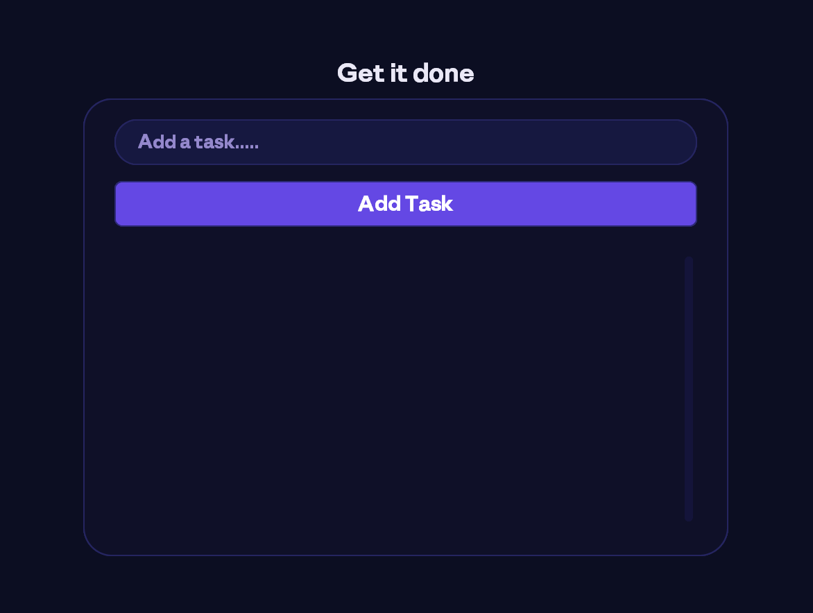
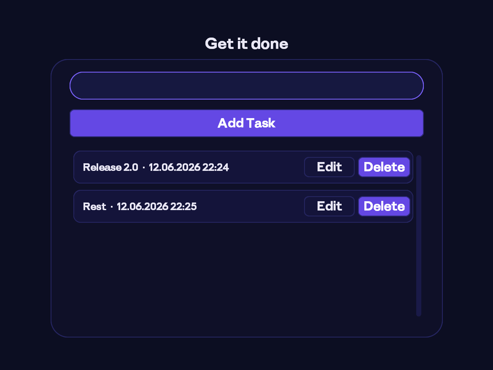
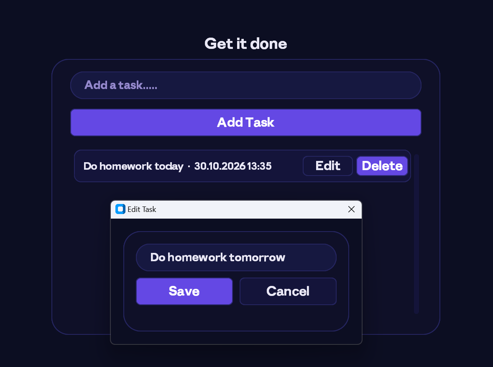

# GetItDone

A desktop task manager built with Python and CustomTkinter.



## Features

- Add, edit, and delete tasks
- Save tasks between launches
- Display task creation dates

## Run from source

```powershell
python -m pip install -r requirements.txt
python main.py
```

Tasks are stored in `tasks.json` beside the application.

## Build the Windows executable

```powershell
python -m pip install -r requirements-build.txt
python -m PyInstaller --clean --noconfirm --onefile --windowed --name GetItDone --icon get_it_done_logo.ico --add-data "assets;assets" --add-data "get_it_done_logo.ico;." main.py
```

The executable is created at `dist/GetItDone.exe`.

## Screenshots






## Licenses

The application source is licensed under the MIT License; see [LICENSE](LICENSE). The bundled JetBrains Mono font is licensed under SIL OFL 1.1; see [assets/OFL.txt](assets/OFL.txt).